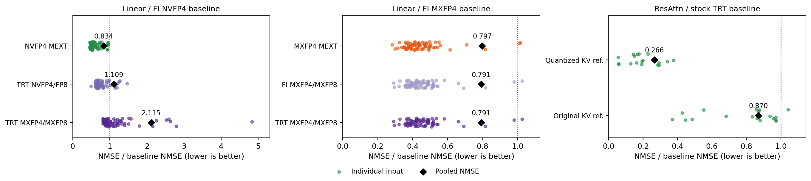
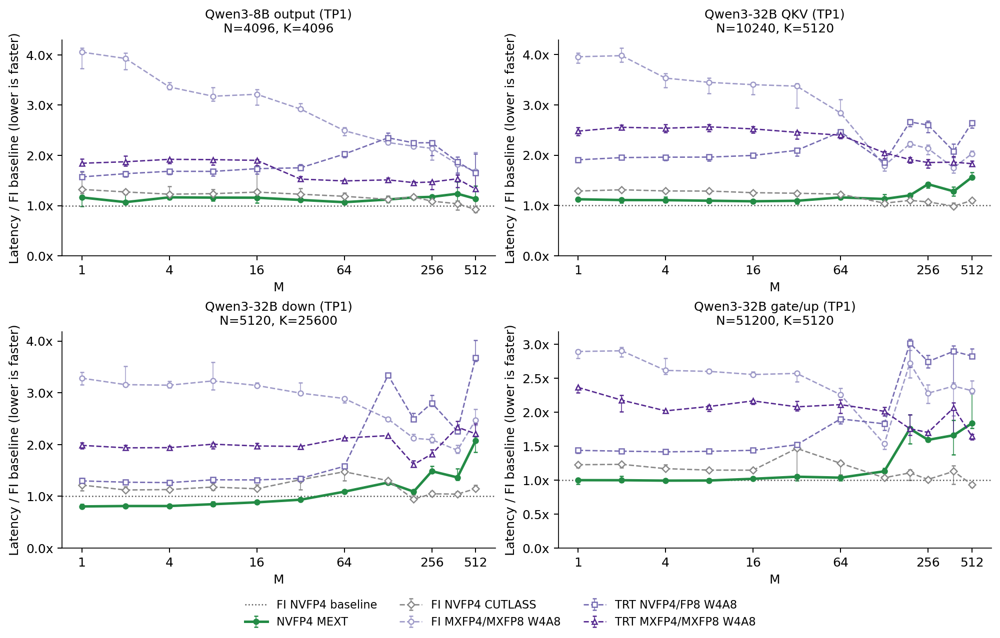
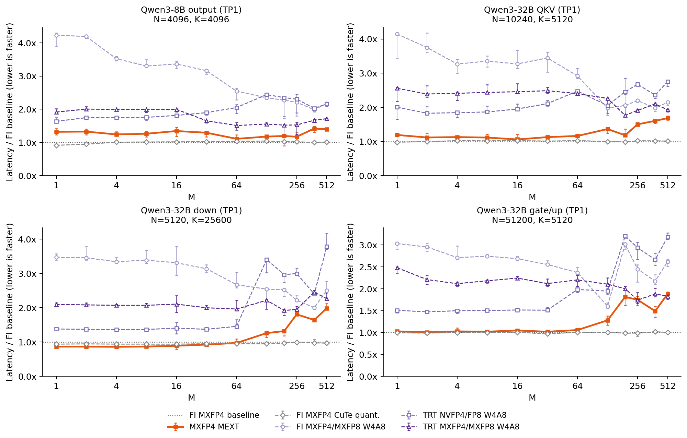
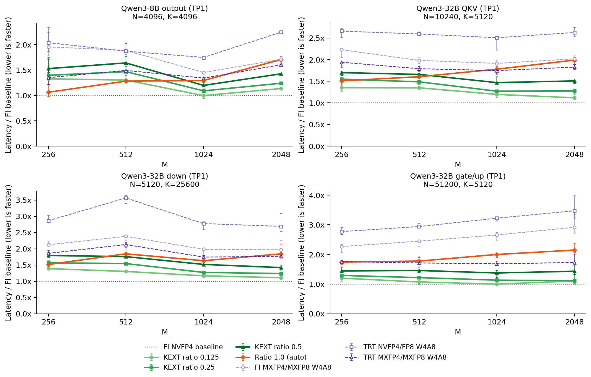
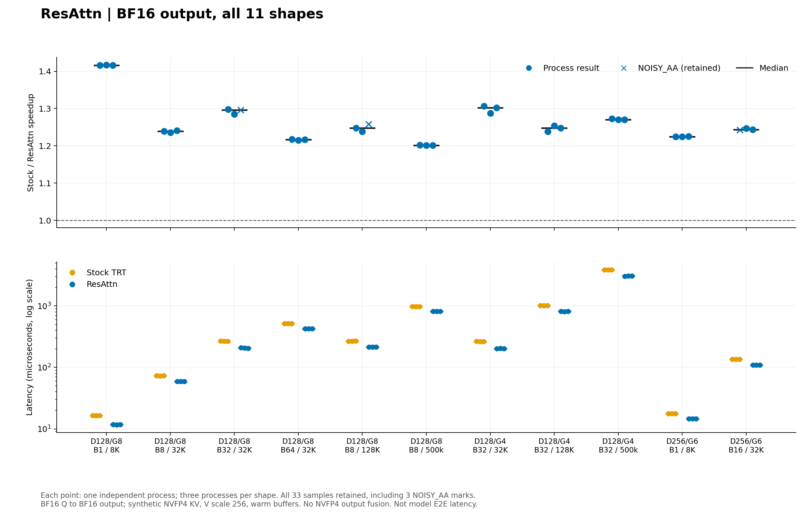

# ResInfer

**Published: October 20, 2026**

ResInfer is a framework for **accurate** and **efficient FP4 inference** on
NVIDIA Blackwell GPUs. It combines **residue error compensation** with
**fused GPU kernels** to reduce quantization error while keeping inference fast.

With **NVFP4 and MXFP4** linear kernels, **NVFP4 decode attention**, ModelOpt
export, FlashInfer autotuning and **vLLM integration**, ResInfer connects
quantization research to practical model serving.

## ✨ Highlights

- **MEXT** compensates activation quantization error with a folded GEMM for
  small token batches, using NVFP4 or MXFP4.
- **KEXT** extends the activation and weight operands along K for selected
  residue channels. Ratio 1.0 uses the full-channel auto path.
- **ResAttn** applies residue compensation to paged NVFP4 decode attention.

<sub>NVFP4 Fold supports SM120 in addition to SM100; MXFP4 MEXT and ResAttn target SM100.</sub>

> ⭐ **Find ResInfer useful?** Give us a star to support the project and help
> more people discover accurate and efficient FP4 inference. We welcome your
> feedback, issues and contributions!

## 📊 Kernel results

The figures below show operator measurements on a B200, not model throughput
or task accuracy. FI denotes FlashInfer; TRT denotes TensorRT-LLM kernels
exposed through FlashInfer.

### Operator precision

**Lower operator error:** MEXT reduces pooled NMSE by **16.6% with NVFP4**
and **20.3% with MXFP4** relative to their respective FI W4A4 baselines
on the captured Qwen3-32B inputs.

Real inputs captured from a frozen Qwen3-32B inference replay are compared
with FP32 references. Points are paired input-level NMSE ratios; diamonds are
ratios of pooled NMSE, computed from total squared error and reference energy.
Lower is better. The sample contains 72 linear inputs per arm and 18 attention
inputs.

Attention has two references: attention computed from dequantized stored KV,
and attention computed from the original BF16 KV before cache quantization.
They separate attention arithmetic error from total local error including KV
storage. These are operator errors, not downstream model-quality scores;
selective KEXT precision is not included in this figure.



### MEXT

Linear latency plots show matched per-process ratios: lines are medians and
error bars are the full range across five sequential process runs. The four
panels use public Qwen3 projection shapes. Performance varies with shape and
batch size; no universal speedup is implied.

MEXT trades a small residue computation for reduced FP4 operator error. Compare
its latency with both W4A4 and W4A8 controls; the W4A4 line is the normalization
baseline, not an accuracy-equivalent implementation. NVFP4 and MXFP4 use their
respective FI baselines.





### KEXT

Selective ratios expose the cost of compensating more channels. These results
use the FlashInfer `mm_fp4(backend="auto")` path and the automatic ratio1
selector. Masks are synthetic for timing; these plots do not establish the
quality of a calibrated checkpoint.



**Linear timing boundary:** activation conversion/quantization and GEMM are
included; weight preparation is excluded. TRT NVFP4/FP8 uses a precomputed
per-tensor activation scale, so its scale estimation is excluded. FI/TRT
MXFP4/MXFP8 include online block quantization and scale generation. NVFP4
paths also use precomputed global scales. Linear measurements use CUDA Graphs
with rotating input buffers.

### ResAttn

On these 11 prepared-KV decode cases, median speedups over stock TRT range
from approximately **1.20× to 1.42×**. Both paths start with BF16 Q and the same
synthetic NVFP4 KV cache and return BF16 output. Stock's Q conversion and output
conversion are included. Timings use warm buffers and CUDA Graphs; cache
construction is excluded. All three process repetitions per case are shown,
including measurements flagged for stock-to-stock timing drift.



## 🚀 Installation

Use Linux x86-64 and Python 3.12 with a compatible CUDA framework stack.
The integration measurements used PyTorch 2.11, vLLM 0.26, FlashInfer 0.7
and CUTLASS DSL 4.8. These versions require coordinated dependency setup;
this source distribution does not provision an environment. Export additionally
requires NVIDIA ModelOpt, Transformers and the checkpoint's tokenizer dependencies.

NVFP4 Fold has SM100 and SM120 implementations. MXFP4 MEXT targets SM100.
ResAttn targets SM100 with head dimensions 128 or 256. Native quantization
build targets do not imply Fold/attention support for every GPU.

With Torch, CUDA build tools and the required libraries already installed:

```bash
python -m pip install --no-build-isolation --no-deps ./csrc
python -m pip install --no-deps -e .
python -m pip install --no-deps ./runtime/vllm_plugin
```

Set `NVFP4_BUILD_ARCHS=sm100` or `sm120` before building to target one GPU
architecture. Build the extension separately in each Torch environment;
CuTeDSL kernels compile on first use.

## 📦 Export a checkpoint

```bash
python -m export.export_nvfp4 \
  --source /path/to/bf16-model \
  --dataset /path/to/calibration.jsonl \
  --output /path/to/new-export \
  --mode residue --format nvfp4 --ratio 0.125 \
  --samples 1024 --seq-len 2048 --batch-size 4
```

The source is a local Hugging Face checkpoint. Each calibration JSONL row
contains `text` or chat `messages`; use the model's own chat template. The
output directory must be new. The checkpoint is written under `checkpoint/`.
Use `--mode preflight` with a separate output directory to check calibration
forward throughput first. Use `--mode plain` for an unextended FP4 export, or
`--format mxfp4` for MXFP4. Supported residue ratios are 0.125, 0.25, 0.5 and 1.0.
Run `--help` for the remaining options.

The exporter uses ModelOpt calibration with a uniform residue ratio.
AWQ, GPTQ and automatic layer-wise budget search are not included.

## ⚡ Serve with vLLM

Install the plugin as above; vLLM loads it in each worker. For a residue NVFP4
checkpoint:

```bash
export VLLM_PLUGINS=residue_patch
export RESIDUE_NVFP4=1
export RESIDUE_VLLM_MODEL_DIR=/path/to/new-export/checkpoint
export RESIDUE_PATCH_MODE=v2
vllm serve "$RESIDUE_VLLM_MODEL_DIR" --dtype bfloat16
```

For MEXT on a **plain NVFP4 checkpoint**, use the same command with
`RESIDUE_PATCH_MODE=mext_r1` and the plain checkpoint directory. Small-M Fold
and larger-M ratio1 prefill retain their automatic selection rules.

For MXFP4, unset `RESIDUE_NVFP4`, set `RESIDUE_MXFP4=1` and use a ModelOpt MXFP4
checkpoint. Its metadata determines the residue mode. Do not enable both
linear format gates for one model.

To enable ResAttn on a supported model, add `RESIDUE_ATTN=1` and vLLM options
`--attention-backend CUSTOM --kv-cache-dtype nvfp4 --block-size 128`.
Prefill uses the upstream path; ResAttn handles decode. Mixed batches are
supported by the adapter, while full CUDA Graph support remains limited to
uniform single-token decode. The kernel plots above use BF16 attention output
without output-quantization fusion.

## 🗂️ Source layout

| Directory | Purpose |
| --- | --- |
| `csrc/` | Native FP4 quantization and CuTeDSL Fold/attention kernels |
| `quant/` | ModelOpt, FlashInfer and vLLM integrations |
| `export/` | Calibration and checkpoint export |
| `runtime/vllm_plugin/` | vLLM worker registration |

This distribution contains the core implementation and selected result figures.
Experiment orchestration, benchmark suites and raw evaluation data are not
included. The figures are measured snapshots, not a guarantee for every model
or environment.

## 🛠️ Roadmap

- [ ] **Paper** — coming soon.
- [ ] **ResMoE** — currently under development and will be released soon.

## 📝 Citation

Our paper will be released soon. In the meantime, you can cite the software
using this temporary entry; we will replace it with the paper citation.

```bibtex
@misc{resinfer2026,
  title = {ResInfer},
  year = {2026},
  note = {Software release, October 20, 2026. Paper forthcoming.}
}
```

## 🙏 Acknowledgements

We thank Modal for providing free credits that enabled access to NVIDIA B200
GPUs for this project.

## ⭐ Star History

[](https://star-history.com/#ShawRong/ResInfer&Date)

## 📄 License

Copyright © 2025–2026 Rong Shuo for ResInfer original work and modifications.
Original work is licensed under Apache-2.0; third-party portions retain their
upstream rights and license conditions. See [LICENSE](LICENSE) and [NOTICE](NOTICE).
